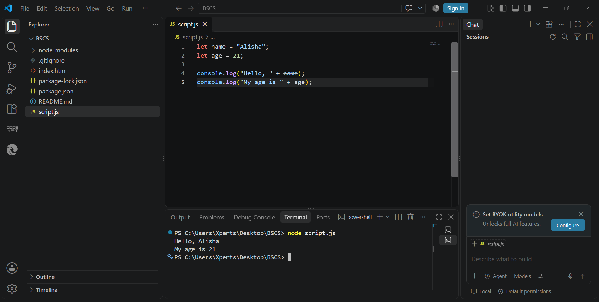
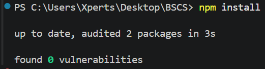
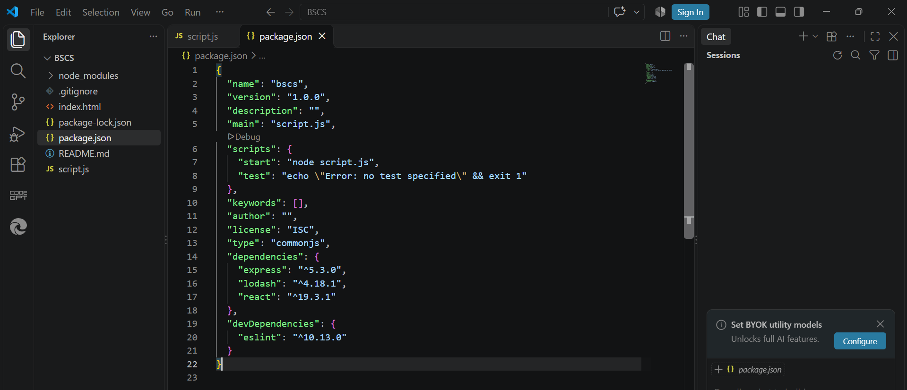
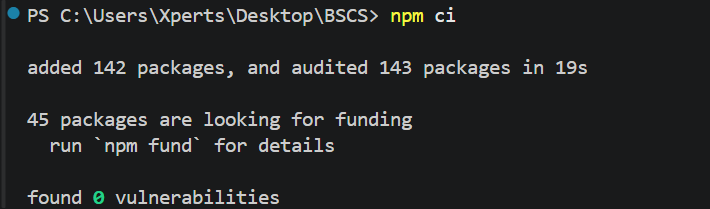
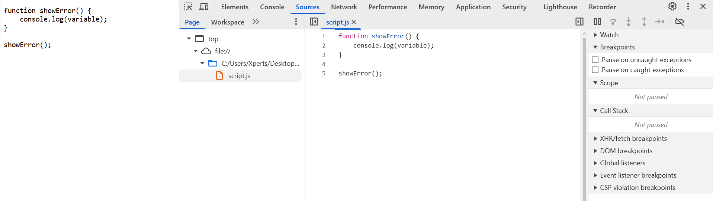

# Advance Web Development Assignment

## Question 1: Design, Set Up, and Justify a Development Environment

### Introduction

A development environment is a set of tools used to write, run, and test
a program. For JavaScript, we use a code editor, Node.js, and a web
browser. It helps team members work easily, find errors, and run the
project smoothly on different computers.

### (a) Select and Justify the Essential Development Tools

We would use the following tools to develop a JavaScript-based web
application.

#### 1. Visual Studio Code (VS Code)

**Purpose:** VS Code is a code editor used to write and manage
JavaScript, HTML, CSS, and other project files. It makes code easier to
read with different colors. It finds coding errors and suggests fixes.
It supports extensions for extra features. It has a terminal to run
commands. It supports Git to track code changes.


** Figure 1: VS Code**

#### 2. VS Code Extensions

Extensions add extra features to VS Code and make coding easier.

-   **Prettier:** It formats code in a consistent style. For example, it
    can help team members use similar indentation and spacing.
-   **ESLint:** It identifies possible JavaScript coding mistakes and
    warns us about some common problems.

We would use these extensions to keep our code clean and organized. They
help us find mistakes and make our code easier to read and maintain.

**Screenshot reference:** Add a relevant screenshot here only if you
took one for the extensions.

#### 3. Node.js

**Purpose:** Node.js is a JavaScript runtime that allows JavaScript code
to run outside a web browser. It is commonly used to run server-side
JavaScript and development tools.

We would install Node.js because many JavaScript projects use it to run
development servers, execute scripts, and manage packages. It also
includes npm by default in its standard installation.

Example (`app.js`):

``` javascript
console.log("Hello World");
```

Run it using:

``` bash
node app.js
```

**Screenshot reference --- Figure 2: Checking Node.js version**


#### 4. Package Manager (npm)

npm stands for Node Package Manager. It helps us install, update, and
manage packages required by a project.

For example, if a project uses React, we can install it using:

``` bash
npm install react
```

**Screenshot reference --- Figure 3: npm install react**


We can use `npm install` to install the packages listed in a project.

``` bash
npm install
```

**Screenshot reference --- Figure 4: npm install**



#### 5. Browser Developer Tools

Browser Developer Tools are built-in tools available in browsers such as
Google Chrome and Microsoft Edge. They help us inspect a webpage, find
JavaScript errors, check network requests, and examine HTML and CSS.

The main panels we would use are:

-   **Console:** Displays JavaScript errors, warnings, and log messages.
-   **Network:** Shows requests for images, scripts, stylesheets, and
    other resources.
-   **Elements:** Allows us to inspect HTML elements and their CSS
    styles.
-   **Sources:** Helps debug JavaScript code.

We would use these tools when a webpage displays incorrect output or an
image fails to load. They help us find the cause of a problem and
correct it.

#### 6. React Developer Tools

React Developer Tools is a browser extension designed for applications
built with React. It allows developers to inspect the React component
tree and examine component properties (props) and state.

For example, if a React component is displaying the wrong text, we can
inspect the component and check whether it is receiving the correct
props or state.

### (b) Explain `package.json`, Dependencies, Development Dependencies, and Lockfile

#### 1. `package.json`

The `package.json` file contains basic information about the project,
including its name, version, scripts, and required packages.

**Screenshot reference --- Figure 5: package.json**



#### 2. Dependencies

Dependencies are packages that an application needs to perform its
functions. For example, a Node.js web server may use Express to handle
HTTP requests.

We can install a package using:

``` bash
npm install express
```

After installation, npm adds the package to the `dependencies` section
of `package.json`. Dependencies are important because developers do not
need to write every feature from the beginning. They can use existing
packages to build applications more efficiently.

**Screenshot reference --- Figure 6: Installing a dependency**


#### 3. Development Dependencies

Development dependencies are packages mainly used during development,
testing, and code maintenance.

For example, Prettier formats code, while ESLint helps identify possible
coding mistakes.

We can install Prettier as a development dependency by running:

``` bash
npm install --save-dev prettier
```

This command adds Prettier to the `devDependencies` section.

A runtime dependency is needed to run the application, while a
development dependency is used to write, test, and check the code.

**Screenshot reference --- Figure 7: Installing a development
dependency**


#### 4. Lockfile

The `package-lock.json` file records exact installed package versions
and dependency details. It helps team members install consistent
versions.

Another developer can install the recorded dependencies using:

``` bash
npm install
```

This command requires a compatible `package-lock.json` file. npm uses
the lockfile to reproduce the recorded package versions when possible.
This reduces the chances of errors caused by package version
differences.

**Screenshot reference --- Figure 8: Lockfile**



### (c) Describe the Steps to Create a Basic Node.js Project and Verify That It Runs

Node.js allows us to run JavaScript outside a web browser. In this part,
we will create a basic Node.js project, write a JavaScript program, and
execute it through the terminal.

#### Step 1: Install Node.js

First, we need to install Node.js from its official website: [Download
Node.js](https://nodejs.org/).

After installation, we open VS Code and select **Terminal → New
Terminal**. We check whether Node.js and npm are installed correctly by
running:

``` bash
node -v
npm -v
```

The first command displays the Node.js version, and the second displays
the npm version. If both commands show version numbers, the installation
is working.

#### Step 2: Create a Project Folder

We create a folder named `my-node-project` and open it in VS Code.

If we are using the terminal, we can run:

``` bash
mkdir my-node-project
cd my-node-project
```

The `mkdir` command creates a folder, while `cd` moves into that folder.
If we have already created and opened the folder in VS Code, we do not
need to create it again.

#### Step 3: Initialize the Project

Run:

``` bash
npm init -y
```

This command creates a `package.json` file with default project
information. It helps npm manage the project and its packages.

After this command, we can see `package.json` in the VS Code Explorer.

#### Step 4: Create the JavaScript File

Create a new file named `app.js` inside the project folder and write the
JavaScript program for the practical.

**Screenshot reference --- Figure 9: Project files and package
configuration**


#### Step 5: Run the Program

Open the terminal in the same project folder and enter the command that
matches the JavaScript filename. For example, if the file is named
`app.js`, run:

``` bash
node app.js
```

Node.js executes the JavaScript file. The expected output for the
assignment's example is `30`.

If the terminal displays an error such as `Cannot find module` or
`Cannot find file`, check the file name, folder location, and command.
Also ensure Node.js is installed correctly.

#### Step 6: Verify the Output

Check that the terminal displays the expected output.

**Screenshot reference --- Figure 10: Node.js program output**


#### Step 7: Verify the Project Structure

The project should contain the relevant files, such as:

``` text
my-node-project/
├── app.js
├── package.json
└── package-lock.json
```

The lockfile will normally be created when npm performs an operation
that resolves and records the dependency tree, such as installing a
package.

### (d) Identify the Browser Developer Tools Panels for Incorrect Output and Failed Image Requests

Sometimes a webpage opens successfully, but its output is incorrect or
an image does not appear. In this situation, we would use Browser
Developer Tools to investigate the problem.

Browser Developer Tools can be opened by pressing **F12** or by
right-clicking the webpage and selecting **Inspect**.

The four useful panels are Console, Network, Elements, and Sources.

#### 1. Console Panel

**Purpose:** The Console panel displays JavaScript errors, warnings, and
messages.

For example, suppose we write:

``` javascript
console.log(name);
```

But the variable `name` has not been declared. The Console may display a
`ReferenceError`. This error helps us identify that the problem is
related to an undefined variable. We can then check the variable name
and correct the code.

**Evidence provided by the Console:**

-   JavaScript error messages.
-   Error names and descriptions.
-   File names and line numbers in many errors.
-   Warnings and debugging messages.

**Screenshot reference --- Figure 11: Console panel showing a JavaScript
error**


#### 2. Network Panel

**Purpose:** The Network panel shows requests made by the webpage. These
requests can include images, CSS files, JavaScript files, and other
resources.

For example, if an image does not load because its file path is
incorrect, we would open the Network panel and reload the webpage. Then
we would select the failed image request and check its URL and status
code.

A `404 Not Found` status usually means that the requested file could not
be found at that address. Other errors may indicate a server problem,
blocked request, or network issue.

**Evidence provided by the Network panel:**

-   The status code of the request.
-   The type of resource requested.
-   The time taken to complete the request.
-   Error information that helps identify why a file failed to load.

**Screenshot reference --- Figure 12: Network panel showing a failed
image request**


#### 3. Elements Panel

**Purpose:** The Elements panel allows us to inspect the HTML structure
and CSS styles of a webpage.

For example, if an image is present in the HTML but does not display
correctly, we can inspect its `` element and check the `src`
attribute.

We can also check whether CSS properties such as `display`, `width`,
`height`, or `visibility` are affecting the element's appearance.

**Evidence provided by the Elements panel:**

-   The image source path in the `src` attribute.
-   CSS properties applied to an element.
-   Whether an element is hidden or incorrectly styled.

The Elements panel helps identify HTML and CSS problems, while the
Network panel helps check whether the image file was successfully
requested.

**Screenshot reference --- Figure 13: Elements panel inspecting HTML and
CSS**


#### 4. Sources Panel

**Purpose:** The Sources panel allows developers to inspect loaded
source files and debug JavaScript using breakpoints.

**Evidence provided by the Sources panel:**

-   Check whether the JavaScript file is loaded correctly.
-   Find the line of code that produces the incorrect output.
-   Set a breakpoint and check the values of variables.
-   Run the code step by step to understand its execution.
-   Check the code to find and fix errors.

**Screenshot reference --- Figure 14: Sources panel**



------------------------------------------------------------------------

## Question 2: Git/GitHub Workflow and Troubleshooting Scenarios

Git is a version control system that helps developers save changes in
their projects. GitHub is an online platform where developers can store
and share their code.

First, we will open the project folder in VS Code and check the
repository status. Then, we will add and commit our files, connect the
local repository to GitHub, and push the code to the `main` branch.

### (a) Git Commands to Upload a Project to GitHub

Git is a tool that helps us track changes in our project. GitHub is an
online platform where we can store and share our code with other
developers.

First, open the project folder in VS Code and open the terminal. Then
use these commands.

#### 1. Check Repository Status

``` bash
git status
```

This command shows which files are new, changed, or ready to commit.

**Screenshot reference --- Question 2, Figure 1: Git status**


#### 2. Add Files to Staging

``` bash
git add .
```

This command prepares the changed files for the next commit. Make sure
unwanted files, such as `node_modules`, are excluded first.

#### 3. Commit Changes

``` bash
git commit -m "Initial project commit"
```

This command saves a snapshot of the current changes in Git history.

**Screenshot reference --- Question 2, Figure 2: Add and commit**


#### 4. Connect the Local Project to GitHub

Use the URL of your own GitHub repository:

``` bash
git remote add origin YOUR_REPOSITORY_URL
```

This command connects the local project to the online GitHub repository.
If `origin` is already configured, check it with `git remote -v` instead
of adding it again.

#### 5. Rename the Branch to Main

``` bash
git branch -M main
```

This command renames the current branch to `main`.

#### 6. Upload the Project

``` bash
git push -u origin main
```

This command uploads the committed changes to GitHub. The `-u` option
sets the upstream branch for easier future pushes.

**Screenshot reference --- Question 2, Figure 3: GitHub repository**


### (b) Why Should `node_modules` Be Excluded Using `.gitignore`?

The `node_modules` folder contains all the packages installed for a
Node.js project. It can be very large, so uploading it to GitHub makes
the repository bigger and slower.

We use a `.gitignore` file to tell Git which files and folders it should
not upload.

Example `.gitignore` content:

``` gitignore
node_modules/
.env
```

-   `node_modules/` prevents the packages folder from being tracked by
    Git.
-   `.env` prevents environment files that may contain private
    information from being tracked. Never upload passwords or API keys.

**Screenshot reference --- Question 2, Figure 4: `.gitignore` file
containing `node_modules/`**


#### Role of `package.json` and the Lockfile

-   **`package.json`:** It contains project information, scripts, and
    the required packages.
-   **`package-lock.json`:** It records the exact installed dependency
    versions and helps different developers install consistent packages.

### (c) Difference Between Commit, Branch, Push, Pull, and Clone

Git commands help developers work together without losing each other's
changes. Each command has a different purpose.

-   **Commit:** Saves a snapshot of changes in Git history.
-   **Branch:** Creates a separate line of work for a new feature or
    task.
-   **Push:** Uploads local commits to GitHub.
-   **Pull:** Downloads and integrates changes from the remote
    repository.
-   **Clone:** Copies a remote repository to your computer.

#### How Branches Help in Teamwork

Suppose two team members are working on the same project. One member is
creating a login page, while the other is working on a home page.

They can create separate branches and work independently. After testing
their changes, they can merge them into the `main` branch.

This approach reduces conflicts and helps prevent one developer from
accidentally overwriting another developer's work.

**Screenshot reference --- Question 2, Figure 5: Branch commands**


### (d) What to Do When a Push Is Rejected?

Sometimes GitHub rejects a push because the remote branch contains
commits that are missing from the local branch. For example, another
team member may have uploaded changes first.

We should not force the push immediately because it can overwrite or
discard remote work.

#### Step 1: Check the Current Status

``` bash
git status
```

This command shows the current state of the local repository.

#### Step 2: Download Remote Changes

``` bash
git fetch origin
```

This command downloads information about remote commits without merging
them into the current branch.

#### Step 3: Integrate the Remote Changes

``` bash
git pull --rebase origin main
```

This command brings the remote `main` branch changes into the local
branch and replays local commits on top of them.

#### Step 4: Resolve Conflicts If They Occur

If Git reports a conflict, open the affected files in VS Code. Check
both versions, combine the correct changes, and save the files. Then
run:

``` bash
git add .
git rebase --continue
```

If there are no conflicts, this step is not required.

#### Step 5: Push Again

``` bash
git push origin main
```

After successfully integrating the remote changes, this command uploads
the local commits.

**Screenshot reference --- Question 2, Figure 6: Pull and
troubleshooting**


#### Why Is Blindly Overwriting Remote History Risky?

Force-pushing without checking remote changes can remove other
developers' commits from the branch history. This may cause lost work
and problems for the whole team. Therefore, we should review and
integrate remote changes before pushing again.

**Screenshot reference --- Question 2, Figure 7: Commit history**


------------------------------------------------------------------------

## Repository Submission

After adding the practical code and actual screenshots to the
repository, commit and push the changes to GitHub. Submit the repository
link to the instructor.
